# OpenGameArt: 3D art

**45 assets from [OpenGameArt](https://opengameart.org), dedicated to the public domain under [CC0](https://creativecommons.org/publicdomain/zero/1.0/).** Use them in any game, free or paid, and change them however you like; no credit is needed.

3D art from OpenGameArt entries licensed CC0 (some also offer other licences; CC0 is the one that applies here). 966.3 MB in all.

This is a copy kept by [zuujis-cc0](https://github.com/zuujis-cc0) so game makers can take single files from GitHub. It is not made by or affiliated with OpenGameArt: the originals, often in more formats and higher resolutions, are on [opengameart.org](https://opengameart.org). If they help you, consider [supporting OpenGameArt](https://opengameart.org/content/faq).

Every file is listed in [MANIFEST.tsv](MANIFEST.tsv) with its size and SHA-256. More free assets: [the Zuujis collection](https://github.com/zuujis-cc0/free-game-assets#readme).

| | | | |
| :-: | :-: | :-: | :-: |
| <a href="2-doors-white-placard">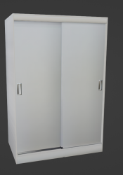</a> <b><a href="2-doors-white-placard">2 Doors white placard</a></b> by DREAM_SEARCH_REPEAT · <a href="https://opengameart.org/content/2-doors-white-placard">source</a> | <a href="30-unique-lowpoly-swords-cc0-swordtember2022">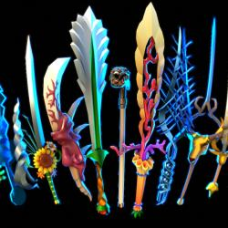</a> <b><a href="30-unique-lowpoly-swords-cc0-swordtember2022">30 Unique Lowpoly Swords CC0 - Swordtember2022</a></b> by CC0 Game Assets · <a href="https://opengameart.org/content/30-unique-lowpoly-swords-cc0-swordtember2022">source</a> | <a href="3d-character-purple-hair-with-bat-basic-rig">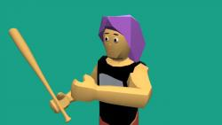</a> <b><a href="3d-character-purple-hair-with-bat-basic-rig">3d character purple hair with bat, basic rig</a></b> by sn2d · <a href="https://opengameart.org/content/3d-character-purple-hair-with-bat-basic-rig">source</a> | <a href="3d-dungeon-debris-paper">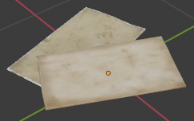</a> <b><a href="3d-dungeon-debris-paper">3D Dungeon debris: paper</a></b> by Paul Wortmann · <a href="https://opengameart.org/content/3d-dungeon-debris-paper">source</a> |
| <a href="3d-goat-animation-for-game">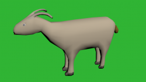</a> <b><a href="3d-goat-animation-for-game">3D goat animation for game</a></b> by tomek · <a href="https://opengameart.org/content/3d-goat-animation-for-game">source</a> | <a href="3d-potion">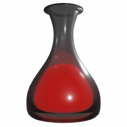</a> <b><a href="3d-potion">3D potion</a></b> by Dellamarque · <a href="https://opengameart.org/content/3d-potion">source</a> | <a href="3d-spaceship">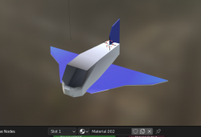</a> <b><a href="3d-spaceship">3d spaceship</a></b> by celleron56 · <a href="https://opengameart.org/content/3d-spaceship">source</a> | <a href="3d-wolf-animation-for-game">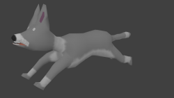</a> <b><a href="3d-wolf-animation-for-game">3D wolf animation for game</a></b> by tomek · <a href="https://opengameart.org/content/3d-wolf-animation-for-game">source</a> |
| <a href="3dsmax-crane-and-bird-box-props">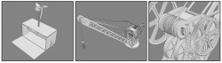</a> <b><a href="3dsmax-crane-and-bird-box-props">3DsMax Crane and Bird Box Props</a></b> by Keiffer · <a href="https://opengameart.org/content/3dsmax-crane-and-bird-box-props">source</a> | <a href="stylized-tree-0">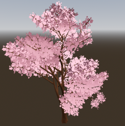</a> <b><a href="stylized-tree-0">Stylized Tree</a></b> by MockingLaugh · <a href="https://opengameart.org/content/stylized-tree-0">source</a> | <a href="swing">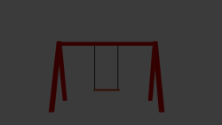</a> <b><a href="swing">Swing</a></b> by Zxelt · <a href="https://opengameart.org/content/swing">source</a> | <a href="sword-and-shieldpixel-texture">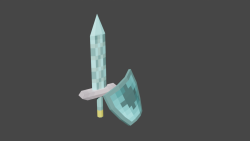</a> <b><a href="sword-and-shieldpixel-texture">Sword and Shield(Pixel Texture)</a></b> by Umplix · <a href="https://opengameart.org/content/sword-and-shieldpixel-texture">source</a> |
| <a href="target-3d-model">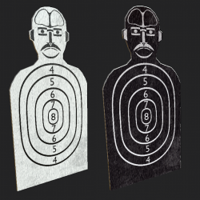</a> <b><a href="target-3d-model">Target 3D Model</a></b> by digitaln8m4r3 · <a href="https://opengameart.org/content/target-3d-model">source</a> | <a href="the-art-block">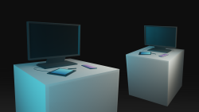</a> <b><a href="the-art-block">The Art Block</a></b> by Hoplite Game Dev · <a href="https://opengameart.org/content/the-art-block">source</a> | <a href="tiny-treats-baked-goods-set">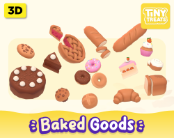</a> <b><a href="tiny-treats-baked-goods-set">Tiny Treats - Baked Goods set</a></b> by Isa Lousberg · <a href="https://opengameart.org/content/tiny-treats-baked-goods-set">source</a> | <a href="tiny-treats-bubbly-bathroom-set">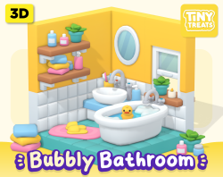</a> <b><a href="tiny-treats-bubbly-bathroom-set">Tiny Treats - Bubbly Bathroom set</a></b> by Isa Lousberg · <a href="https://opengameart.org/content/tiny-treats-bubbly-bathroom-set">source</a> |
| <a href="tiny-treats-charming-kitchen-set">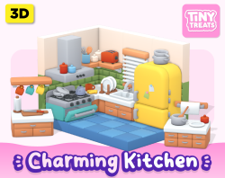</a> <b><a href="tiny-treats-charming-kitchen-set">Tiny Treats - Charming Kitchen set</a></b> by Isa Lousberg · <a href="https://opengameart.org/content/tiny-treats-charming-kitchen-set">source</a> | <a href="tiny-treats-homely-house-set">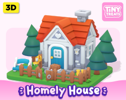</a> <b><a href="tiny-treats-homely-house-set">Tiny Treats - Homely House set</a></b> by Isa Lousberg · <a href="https://opengameart.org/content/tiny-treats-homely-house-set">source</a> | <a href="tiny-treats-pretty-park-set">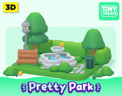</a> <b><a href="tiny-treats-pretty-park-set">Tiny Treats - Pretty Park set</a></b> by Isa Lousberg · <a href="https://opengameart.org/content/tiny-treats-pretty-park-set">source</a> | <a href="toilets">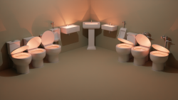</a> <b><a href="toilets">Toilets</a></b> by loafbrr_1 · <a href="https://opengameart.org/content/toilets">source</a> |
| <a href="tomato-cc0">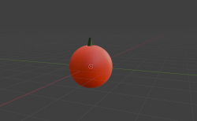</a> <b><a href="tomato-cc0">Tomato | CC0</a></b> by Zxelt · <a href="https://opengameart.org/content/tomato-cc0">source</a> | <a href="tool-pack-1">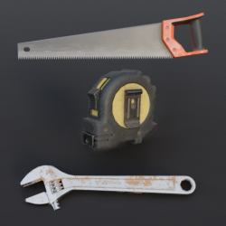</a> <b><a href="tool-pack-1">Tool Pack 1</a></b> by LonesomeDucky · <a href="https://opengameart.org/content/tool-pack-1">source</a> | <a href="tool-pack-2">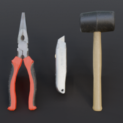</a> <b><a href="tool-pack-2">Tool Pack 2</a></b> by LonesomeDucky · <a href="https://opengameart.org/content/tool-pack-2">source</a> | <a href="toolbox-0">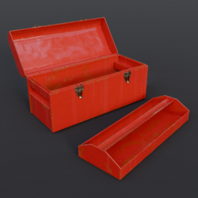</a> <b><a href="toolbox-0">Toolbox</a></b> by LonesomeDucky · <a href="https://opengameart.org/content/toolbox-0">source</a> |
| <a href="toon-cat-humanoid">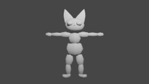</a> <b><a href="toon-cat-humanoid">Toon Cat Humanoid</a></b> by MarshReaper · <a href="https://opengameart.org/content/toon-cat-humanoid">source</a> | <a href="toon-styled-stuff">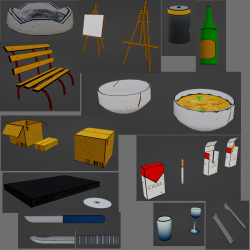</a> <b><a href="toon-styled-stuff">Toon Styled Stuff</a></b> by DREAM_SEARCH_REPEAT · <a href="https://opengameart.org/content/toon-styled-stuff">source</a> | <a href="transparent-plastic-bucket">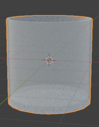</a> <b><a href="transparent-plastic-bucket">Transparent Plastic Bucket</a></b> by neincenets · <a href="https://opengameart.org/content/transparent-plastic-bucket">source</a> | <a href="uaz-452-utility-van-lowpoly">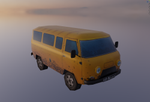</a> <b><a href="uaz-452-utility-van-lowpoly">UAZ-452 Utility Van Lowpoly</a></b> by Mehozavr · <a href="https://opengameart.org/content/uaz-452-utility-van-lowpoly">source</a> |
| <a href="update-face">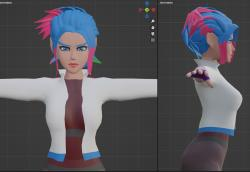</a> <b><a href="update-face">UPDATE FACE</a></b> by byzmod3d · <a href="https://opengameart.org/content/update-face">source</a> | <a href="update-face-woman">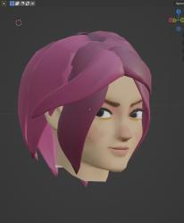</a> <b><a href="update-face-woman">Update Face woman</a></b> by byzmod3d · <a href="https://opengameart.org/content/update-face-woman">source</a> | <a href="very-low-poly-humano%C3%AFd">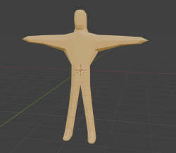</a> <b><a href="very-low-poly-humano%C3%AFd">Very Low Poly Humanoïd</a></b> by Zxelt · <a href="https://opengameart.org/content/very-low-poly-humano%C3%AFd">source</a> | <a href="vintage-cotton-mattress-3d">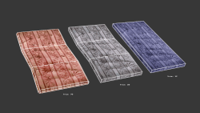</a> <b><a href="vintage-cotton-mattress-3d">Vintage Cotton Mattress 3D</a></b> by GGBotNet · <a href="https://opengameart.org/content/vintage-cotton-mattress-3d">source</a> |
| <a href="voxel-classical-guitar">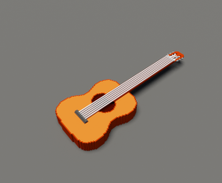</a> <b><a href="voxel-classical-guitar">Voxel Classical Guitar</a></b> by MonoTone · <a href="https://opengameart.org/content/voxel-classical-guitar">source</a> | <a href="voxel-pumpkin">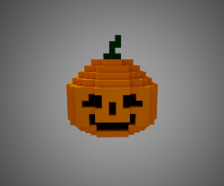</a> <b><a href="voxel-pumpkin">Voxel Pumpkin</a></b> by MonoTone · <a href="https://opengameart.org/content/voxel-pumpkin">source</a> | <a href="voxel-roboter">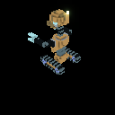</a> <b><a href="voxel-roboter">voxel roboter</a></b> by mattn · <a href="https://opengameart.org/content/voxel-roboter">source</a> | <a href="voxel-skeleton">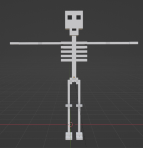</a> <b><a href="voxel-skeleton">Voxel Skeleton</a></b> by skeletonlord123 · <a href="https://opengameart.org/content/voxel-skeleton">source</a> |
| <a href="voxel-vending-machine">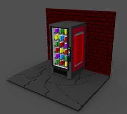</a> <b><a href="voxel-vending-machine">Voxel Vending Machine</a></b> by MonoTone · <a href="https://opengameart.org/content/voxel-vending-machine">source</a> | <a href="vroid-studio-cc0-models">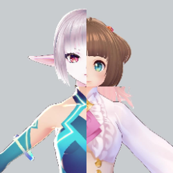</a> <b><a href="vroid-studio-cc0-models">VRoid Studio CC0 models</a></b> by hecko · <a href="https://opengameart.org/content/vroid-studio-cc0-models">source</a> | <a href="warrior-female-3d-model">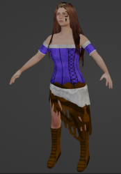</a> <b><a href="warrior-female-3d-model">Warrior Female - 3D model</a></b> by DREAM_SEARCH_REPEAT · <a href="https://opengameart.org/content/warrior-female-3d-model">source</a> | <a href="wayb-props">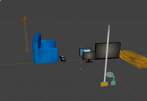</a> <b><a href="wayb-props">WAYB props</a></b> by DREAM_SEARCH_REPEAT · <a href="https://opengameart.org/content/wayb-props">source</a> |
| <a href="woman-in-action-outfit">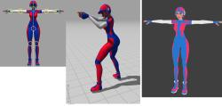</a> <b><a href="woman-in-action-outfit">Woman in Action Outfit</a></b> by byzmod3d · <a href="https://opengameart.org/content/woman-in-action-outfit">source</a> | <a href="wood-furnitures-2">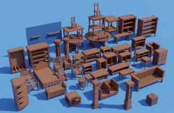</a> <b><a href="wood-furnitures-2">Wood Furnitures 2</a></b> by loafbrr_1 · <a href="https://opengameart.org/content/wood-furnitures-2">source</a> | <a href="wood-stuff">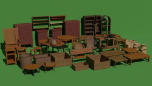</a> <b><a href="wood-stuff">Wood Stuff</a></b> by loafbrr_1 · <a href="https://opengameart.org/content/wood-stuff">source</a> | <a href="wooden-logs">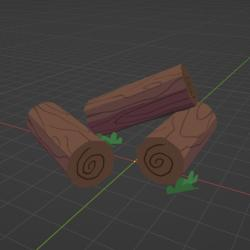</a> <b><a href="wooden-logs">Wooden Logs</a></b> by Mish7913 · <a href="https://opengameart.org/content/wooden-logs">source</a> |
| <a href="woodkitchen">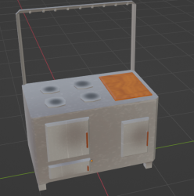</a> <b><a href="woodkitchen">Woodkitchen</a></b> by DREAM_SEARCH_REPEAT · <a href="https://opengameart.org/content/woodkitchen">source</a> |  |  |  |

---

Kept up to date by this repository's own [update workflow](.github/workflows/update.yml), with code and plan from [cc0-mirror](https://github.com/zuujis-cc0/cc0-mirror). Something wrong? [Open an issue there](https://github.com/zuujis-cc0/cc0-mirror/issues/new) or use the [private report form](https://games.zuujis.com/report).
